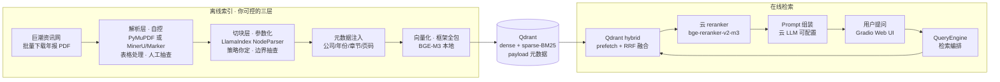

# 混合检索 RAG · 技术方案 v2

> 版本：v2（选型闭环，未开始实现）
> 日期：2026-09-08
> 基于：`01-技术选型对比.md`（v1，保留不动）+ 四轮沟通决策
> 状态：**方案探讨阶段，未写任何实现代码**

---

## 变更摘要（v1 → v2）

| 变更项 | v1 | v2 | 原因 |
|---|---|---|---|
| 数据源 | 公开数据集（C-MTEB）+ 自建语料 | **巨潮资讯网上市公司年报 PDF**（中等规模 50~100 份） | 用户变更，贴近真实业务场景 |
| 开发框架 | 待定（LlamaIndex 倾向） | **LlamaIndex 确认** | Qdrant hybrid 开箱即用、组件可替换适合对照实验 |
| PDF 解析层 | 未涉及 | **新增：解析自控**（用户选工具+抽查质量） | 年报财务表格是解析大坑，框架救不了解析失败 |
| 切块分工 | 框架默认 | **参数化**：NodeParser 执行、策略用户定、切完人工抽查 | "手动切块"澄清为"策略自定"而非手工劳动 |
| 向量化分工 | 本地 BGE-M3 | **框架全包**（配置一行），模型不变 | 手动向量化无收益 |
| 评测方案 | C-MTEB 三层组合 | **搁置，标为待定**；年报自建评测为方向，但集子尚未建 | 用户决定先跑通链路，评测后议 |
| 元数据设计 | 提及 | **升级为刚需设计**：公司/年份/章节/页码 | 年报场景的过滤与引用溯源依赖它 |

不变项：Qdrant、embedding 本地 BGE-M3 + reranker 云 API（硅基流动免费额度）、云 LLM 可配置多模型、Gradio Web UI、验证优先、1 周内出可跑版本。

---

## 1. 已确认决策总表（四轮累计）

| # | 决策点 | 结论 | 备注 |
|---|---|---|---|
| D1 | 目标权重 | **验证优先，能用其次** | 对照实验表是核心交付物 |
| D2 | 检索引擎 | **Qdrant** | 资源占用低、混合检索 API 优雅；中文分词客户端 jieba |
| D3/D4 | 模型部署 | **embedding 本地 BGE-M3 + reranker 云 API** | 避开 4~6G 显存 OOM；硅基流动 rerank 免费 |
| D5 | 开发框架 | **LlamaIndex** | 见 §3 分析 |
| D7 | 交付形态 | **Gradio Web UI** | 展示对照实验结果 |
| — | 云 LLM | **可配置、多模型兼容**（OpenAI 兼容层） | DeepSeek/Qwen 等随时切换 |
| — | 数据源 | **巨潮资讯网年报 PDF** | 公开法定披露信息，学习研究使用无碍 |
| — | 语料规模 | **中等：50~100 份**（万级 chunk） | 索引数小时；按可分批增量入库设计 |
| — | 工期 | **1 周内出可跑版本** | 只跑核心链路 + E0/E3 两组 |
| E1 | 评测集 | **搁置** | 见 §6，备选方案已留档 |

## 2. 系统架构（v2）

数据流两句话：**离线**——巨潮下载 PDF → 你把关解析 → NodeParser 按你定的策略切块 → 注入元数据 → 框架调本地 BGE-M3 向量化 → 存入 Qdrant（稠密 + 稀疏两套索引）；**在线**——Gradio 提问 → Qdrant hybrid（dense + BM25 prefetch + RRF）召回 → 云 reranker 重排 → top 3~5 拼 Prompt → 可配置云 LLM 生成，带引用溯源。

## 3. 框架结论：为什么是 LlamaIndex 而不是 LangChain

你接管解析+切块+向量化后，框架剩余职责只有：检索编排、Prompt、LLM 调用、评测/UI 脚手架。在这个范围内：

| 维度 | LlamaIndex ✅ | LangChain |
|---|---|---|
| Qdrant 混合检索 | `QdrantVectorStore` 原生 hybrid（dense+sparse+RRF） | 需自定义 retriever 组装，代码散 |
| 元数据过滤 | Node metadata → payload filter 一等公民 | 要绕一层 |
| 对照实验 | 换个 Retriever/NodeParser 就是一组实验 | 常与框架"聪明默认值"打架 |
| 你的场景契合 | RAG 垂直 | 优势在 Agent/工具链，本项目用不上 |

**不选自研的原因**：虽然编排只剩约 150~200 行，但评测脚手架（E0~E4 跑批、指标计算）框架白送，1 周工期内这是决定性的。
**不选 LangChain 的原因**：生态优势场景与本项目错位；仅当课程代码配套 LangChain 时才值得重新考虑。

## 4. 数据源：巨潮年报的实施要点（方案级，不含代码）

### 4.1 下载
- 巨潮资讯网提供公告检索接口（`hisAnnouncement/query`），可按**股票代码 + 公告类别（年报 category_ndbg_szsh）+ 时间范围**筛选，返回 PDF 直链（`static.cninfo.com.cn/finalpage/...`）
- 注意限频，批量下载加间隔与重试；实施前先用 2~3 个代码验证接口行为
- 年报为公开法定披露信息，个人学习研究使用无合规问题

### 4.2 解析（你把关的第一道关）
- **财务报表（资产负债表/利润表/现金流量表）是复杂表格**，PyMuPDF 纯文本流会抽出错乱结果；MinerU / Marker 版面还原可保表格结构但更重
- 建议：第一版用轻量方案（PyMuPDF）解析全文 + **财务报表段落单独处理**；抽查 2~3 份的解析质量后再定是否升级版面还原工具
- 年报章节结构标准（"第四节 经营情况讨论与分析"、"第十节 财务报告"），**目录书签可作为切块边界的现成参考**

### 4.3 元数据设计（v2 刚需）
每个 chunk 注入：

| 字段 | 用途 |
|---|---|
| `company_name` / `stock_code` | 按公司过滤 |
| `fiscal_year` | 按年份过滤（跨年对比问题的前提） |
| `section`（章节名） | 按章节过滤（"只在财务报告章节找"） |
| `page_no` / `chunk_idx` | 引用溯源（答案标注出处页码） |
| `chunk_type`（正文/表格/列表） | 表格类 chunk 单独标记，检索时可区分处理 |

这套元数据是**混合检索之外的第二层精度来源**：Qdrant payload filter + Text Match（关键词预过滤）与 RRF 融合正交，可叠加使用。

### 4.4 切块（参数化，非手工）
- 第一版基线：`SentenceSplitter(chunk_size≈512, overlap≈50)`，跑通后再试结构感知切分（按章节）、small-to-big
- 每份切完**抽查边界**（尤其章节衔接与表格处）——这就是"手动"的正确形态：决策在你，执行在代码
- 切分粒度本身就是对照实验的变量之一

## 5. 对照实验矩阵（不变，核心交付物）

| 组 | dense | BM25 | RRF | reranker | 说明 |
|---|---|---|---|---|---|
| E0 | ✅ | | | | 纯向量 baseline |
| E1 | | ✅ | | | 纯 BM25（验证 jieba 分词配对） |
| E2 | ✅ | ✅ | ✅ | | 混合检索增益 |
| E3 | ✅ | ✅ | ✅ | ✅ | 完整链路（1 周目标：E0 vs E3 两组出数字） |
| E4 | BGE-M3 sparse 替代 BM25 | | ✅ | ✅ | learned sparse vs 经典 BM25 |

另可加两组年报场景特有变量：**切分粒度**（512 vs 1024）与 **元数据过滤开关**（有无章节过滤）。

## 6. 评测方案：搁置中（回来时从这里接续）

**当前决定**：评测集先搁置，链路跑通后再定。以下是搁置前讨论过的三个备选，将来启用时直接从中挑：

| 备选 | 内容 | 代价 |
|---|---|---|
| 扩集+粗粒度调参 | 年报自建 100~150 条问答对，只做粗调（RRF vs 加权、dense 权重三档），不细调 k | 标注工作量大，但结论可靠 |
| 年报验证 + C-MTEB 调参 | 50 条年报集做最终验收，调参场用 C-MTEB DuRetrieval | 多备一套数据 |
| 定性 bad case 分析 | 每组抽 20 查询人工对比，不建数值集 | 最快，但拿不出对外数字 |

**遗留风险（记录在案）**：年报自建评测 <200 条时，RRF 参数调优结论有噪声风险——这是将来启用评测时必须面对的约束，不是可以忽略的技术细节。

v1 文档 §8.2 的 C-MTEB 子任务规模核查表（T2Retrieval 230 万段落不可行等结论）保留作参考，若将来启用"年报验证 + C-MTEB 调参"备选，直接引用该表选子任务。

## 7. 里程碑（1 周可跑版）

| 阶段 | 产出 | 验收标准 |
|---|---|---|
| M1 下载+解析（约 2 天） | 50~100 份年报 PDF 本地化；解析脚本跑通；2~3 份人工抽查通过 | 表格段落解析质量可接受 |
| M2 切块+索引（约 1~2 天） | 元数据 schema 定稿；NodeParser 参数化；Qdrant collection 建好，数据入库 | 万级 chunk 入库成功；payload 可过滤 |
| M3 检索链路（约 1~2 天） | Qdrant hybrid + RRF + 云 reranker + 可配置 LLM；Gradio UI | 能对年报提问，答案带引用出处 |
| M4 首组对照（约 1 天） | E0 vs E3 跑批，出第一张对比表 | 有 Recall@K/nDCG@10 数字 |

M4 之后：评测集决策（§6 三选一）→ 扩跑 E1/E2/E4 → 切分粒度对照 → 增量入库。

## 8. 风险清单（v2）

| 风险 | 等级 | 缓解 |
|---|---|---|
| 年报财务表格解析质量差 | **高** | M1 人工抽查前置；表格 chunk 单独标记处理；必要时升级 MinerU/Marker |
| 评测集未建，效果改进无量化依据 | 中 | 已搁置但有备选方案（§6）；M4 的 E0/E3 对照可先用少量查询粗验 |
| 巨潮接口限频/结构变更 | 中 | 下载加间隔重试；PDF 本地化后接口依赖即解除 |
| 4~6G 显存跑 BGE-M3 索引批次过大 OOM | 中 | 批量调小；兜底方案：embedding 也切云 API（同 key 免费额度） |
| 50~100 份 × 数百 chunk 的元数据标注遗漏 | 低 | schema 字段从下载清单自动生成，不手工填 |

---

## 附：核查来源

v1 文档附录的核查结论全部继续有效（Milvus/Qdrant 能力、显存数字、RRF 阈值、硅基流动 API 规格）。v2 新增内容中：
- 巨潮接口与年报类别代码：基于公开资料整理，**实施前需实测验证**
- LlamaIndex 与 LangChain 能力对比：基于两框架官方文档通用认知，实施时以当前版本实测为准
